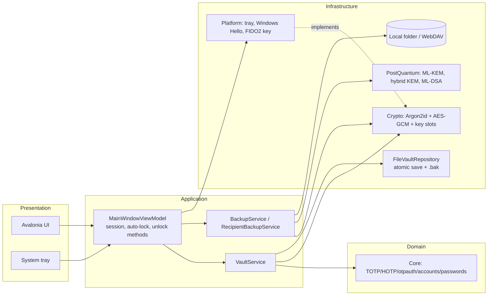
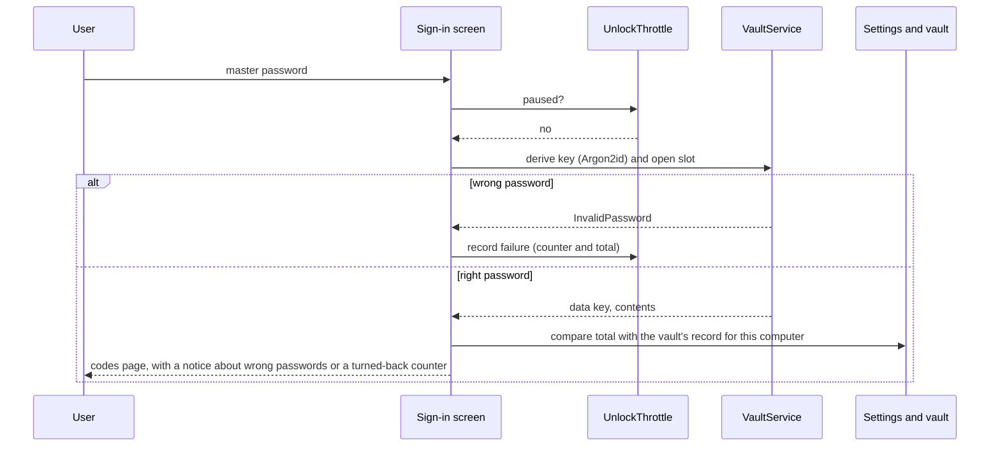

# Architecture

## Projects

| Project | Role | Targets |
| --- | --- | --- |
| **MasterSafe.Core** | Pure OTP and account domain logic, no dependencies | net10.0 |
| **MasterSafe.Crypto** | Argon2id, AES-256-GCM, vault format 3 and key slots, `ISecretProvider`, atomic repository, bounded GZip | net10.0 |
| **MasterSafe.PostQuantum** | ML-KEM-768, hybrid ECDH-P384+ML-KEM-768, ML-DSA-65 signer and verifier, the signed release manifest, the list of installed files (`InstalledFiles`) | net10.0 |
| **MasterSafe.Backup** | Password and recovery-key `.sauth` backups; local folder and WebDAV (https only) providers; sync; KeePass export; the recovery key on paper (`PaperKey`) and in 3 parts (`KeySplitter`, Shamir 2 of 3) | net10.0 |
| **MasterSafe.QR** | QR decode (several codes in one photo) and generation, including large print codes for the paper key | net10.0 |
| **MasterSafe.Data** | EF Core SQLite persistence; not used by the app at present | net10.0 |
| **MasterSafe.Platform** | Tray abstraction; `WindowsHelloProvider`, `Fido2HmacSecretProvider` (Windows WebAuthn) and `PlatformServices` | net10.0 (Linux) or net10.0-windows10.0.19041.0 (Windows) |
| **MasterSafe.App** | Avalonia desktop app: sidebar, screens, splash, view models | same as Platform |
| **MasterSafe.Cli** | Release tools: `verify-release`, `verify`, `fingerprint`, `check-installed`; for maintainers `keygen`, `sign`, `manifest`, `installed-files` | net10.0 |
| **MasterSafe.Tests** | xUnit tests | same as Platform |

The Windows target framework is selected by the `MasterSafeWindowsTarget` MSBuild property in
`Directory.Build.props`: true on Windows hosts, or with `-p:MasterSafeTargetOs=windows`; build for Linux from
any host with `-p:MasterSafeTargetOs=linux`. Windows-only code sits behind `#if WINDOWS`.

## Application services

`MasterSafe.App/Services` holds the pieces that are not screens, so they can be tested without a window:

| Type | Role |
| --- | --- |
| `AppPaths` | Where files live (`%LocalAppData%\MasterSafe` or `~/.local/share/MasterSafe`), see [FileLocations.md](FileLocations.md) |
| `SettingsStore`, `AppSettings` | Settings saved as JSON, written atomically; no secrets |
| `VaultCatalog` | Lists vault files, archives the old vault, switches the active vault, deletes only inside the app folder |
| `SingleInstance` | One running copy: a lock file held open, and a pipe a second start uses to bring the first forward |
| `VaultPathSafety` | Recognises network paths without touching the network |
| `SaveCounterStore` | The copy of each vault's save counter, outside the vault file |
| `WebsiteIconFetcher`, `IconImageCheck` | The optional website icon, with its fixed rules |
| `EmergencySheet` | The printable page |
| `VaultMerger`, `EntryExtras` (Crypto) | Joins two copies of a vault; keeps new fields safe from older versions |
| `SyncService`, `SyncPackage`, `SyncCode`, `KdbxWriter` (Backup) | Sync through a folder or WebDAV; KeePass export |
| `AppExportImporter`, `GoogleMigration` (Core) | Exports of other apps |
| `SwitchableVaultRepository` (Crypto) | A vault repository whose file can change at run time |
| `IFileDialogs`, `WindowFileDialogs` | File and folder pickers behind an interface |
| `AppServices` | The bundle passed to the view models; absent in design and test mode |
| `RecoveryKeyService`, `RecipientBackupService` (Backup) | Recovery key files and recovery backups |
| `PaperKey`, `RecoveryKeySheet` | The recovery key as QR codes and text pieces, and the printable page that holds them |
| `KeySplitter` (Backup) | Splits the passphrase-locked key file into 3 parts, any 2 of which rebuild it |
| `UnlockThrottle`, `ElapsedClock` | The pause after wrong master passwords, timed by the tick count, and a total that only goes up |
| `CopyGuard` | Pauses copying after many secrets were copied in a short time |
| `UpdateChecker`, `ReleaseKey` | The signed update check, and the comparison of the installed-files list with the signed release |
| `ProgramFiles`, `InstalledFiles` (PostQuantum) | The start-up check of the program's own files |

View models added for these: `VaultsViewModel` (with the daily copies), `RecoveryViewModel`, `ForgotPasswordViewModel` (key file, paper key or key parts), `SyncViewModel`, `SecurityEventsViewModel`, `UpdatesViewModel`.

## Unlocking, step by step

## Principles

- Offline-first: no network dependency to generate codes.
- Dependency direction: Core has no outward dependencies; Crypto depends on Core; Backup depends on Crypto and PostQuantum;
  Platform depends on Crypto; the app depends on all of them.
- Hardware and OS unlock methods implement `ISecretProvider` (Windows Hello and FIDO2 security keys; Linux backends later), so the vault format
  and view models do not depend on a platform.
- Interfaces (`IVaultService`, `IVaultRepository`, `IEncryptionService`, `IMasterPasswordService`,
  `ISecretProvider`) enable dependency injection and testing.
- Anything read from a file or the network is validated and size-limited before use.

## Packaging

`installer/build-windows.ps1` publishes a self-contained win-x64 build, writes `installed-files.txt` and runs Inno Setup.
`installer/linux/build-linux.sh` publishes self-contained linux-x64 or linux-arm64 and creates a tar.gz with an
install script, with `installed-files.txt` in the program folder; `installer/linux/build-deb.sh` turns that archive into a `.deb`. `.github/workflows/release.yml` builds everything on a version tag, and `scripts/sign-release.ps1` signs it offline. See [README.md](../README.md) and [ReleaseProcess.md](ReleaseProcess.md).
