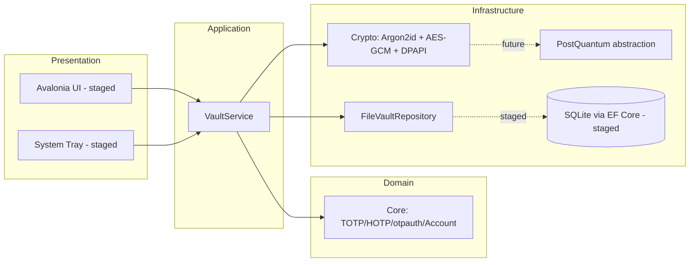

# Architecture

## Projects

- **SafeAuthenticator.Core** — pure, dependency-free OTP domain logic.
- **SafeAuthenticator.Crypto** — encryption, KDF, vault orchestration and persistence interfaces.
- **SafeAuthenticator.PostQuantum** — ML-KEM-768 shaped abstraction for future hybrid encryption.
- **SafeAuthenticator.Tests** — xUnit tests with RFC vectors.

## Principles

- Offline-first: no network dependency to generate codes.
- Clean dependency direction: Core has no outward dependencies; Crypto depends on Core.
- Interfaces (`IVaultService`, `IVaultRepository`, `IEncryptionService`, `IMasterPasswordService`)
  enable DI and testability.
