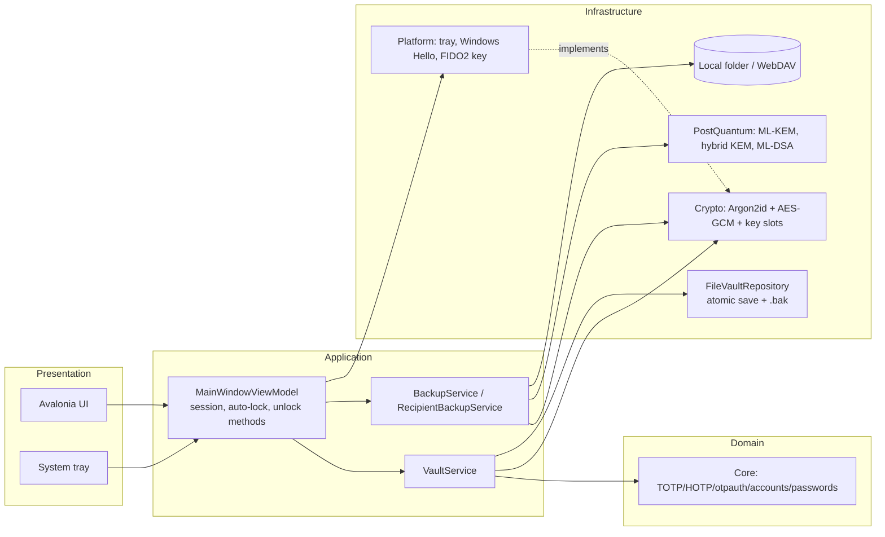

# Architecture

## Projects

| Project | Role | Targets |
| --- | --- | --- |
| **MasterSafe.Core** | Pure OTP and account domain logic, no dependencies | net10.0 |
| **MasterSafe.Crypto** | Argon2id, AES-256-GCM, vault format 3 and key slots, `ISecretProvider`, atomic repository, bounded GZip | net10.0 |
| **MasterSafe.PostQuantum** | ML-KEM-768, hybrid ECDH-P384+ML-KEM-768, ML-DSA-65 signer | net10.0 |
| **MasterSafe.Backup** | Password and recovery-key `.sauth` backups; local folder and WebDAV (https only) providers | net10.0 |
| **MasterSafe.QR** | QR decode and generation | net10.0 |
| **MasterSafe.Data** | EF Core SQLite persistence; not used by the app at present | net10.0 |
| **MasterSafe.Platform** | Tray abstraction; `WindowsHelloProvider`, `Fido2HmacSecretProvider` (Windows WebAuthn) and `PlatformServices` | net10.0 (Linux) or net10.0-windows10.0.19041.0 (Windows) |
| **MasterSafe.App** | Avalonia desktop app: sidebar, screens, splash, view models | same as Platform |
| **MasterSafe.Cli** | Demo and release signing commands | net10.0 |
| **MasterSafe.Tests** | xUnit tests | same as Platform |

The Windows target framework is selected by the `MasterSafeWindowsTarget` MSBuild property in
`Directory.Build.props`: true on Windows hosts, or with `-p:MasterSafeTargetOs=windows`; build for Linux from
any host with `-p:MasterSafeTargetOs=linux`. Windows-only code sits behind `#if WINDOWS`.

## Principles

- Offline-first: no network dependency to generate codes.
- Dependency direction: Core has no outward dependencies; Crypto depends on Core; Backup depends on Crypto and PostQuantum;
  Platform depends on Crypto; the app depends on all of them.
- Hardware and OS unlock methods implement `ISecretProvider` (Windows Hello and FIDO2 security keys; Linux backends later), so the vault format
  and view models do not depend on a platform.
- Interfaces (`IVaultService`, `IVaultRepository`, `IEncryptionService`, `IMasterPasswordService`,
  `ISecretProvider`) enable dependency injection and testing.
- Anything read from a file or the network is validated and size-limited before use.

## Packaging

`installer/build-windows.ps1` publishes a self-contained win-x64 build and runs Inno Setup.
`installer/linux/build-linux.sh` publishes self-contained linux-x64 or linux-arm64 and creates a tar.gz with an
install script. `.github/workflows/release.yml` builds both on a version tag. See [README.md](../README.md).
