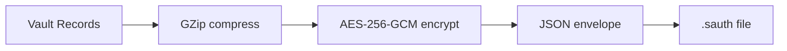

# Backup Format (`.sauth`)

A `.sauth` backup is the encrypted vault serialized as JSON. **No plaintext export is produced by default.**

## Flow



## JSON envelope

```json
{
  "Version": 1,
  "Salt": "<base64 Argon2id salt>",
  "KdfParameters": { "MemorySizeKib": 65536, "Iterations": 3, "DegreeOfParallelism": 4, "KeyLength": 32 },
  "Nonce": "<base64 12-byte AES-GCM nonce>",
  "Tag": "<base64 16-byte GCM tag>",
  "Ciphertext": "<base64 encrypted+compressed records>",
  "Compressed": true
}
```

## Restore

Restore re-derives the KEK from `Salt` + `KdfParameters` and the user's master password, then
AES-GCM-decrypts and GZip-decompresses the records. Integrity is enforced by the GCM tag.
