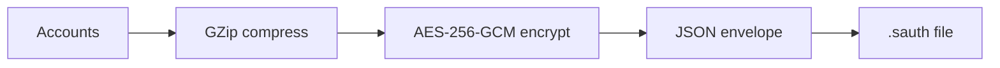

# Backup Formats (`.sauth`)

A `.sauth` backup is an encrypted file. **No plaintext export is produced.** Two kinds exist.

## 1. Password backup (version 1)

Encrypted with a key derived from the master password. Created from the Backup screen.



```json
{
  "Version": 1,
  "Salt": "<base64 Argon2id salt>",
  "KdfParameters": { "MemorySizeKib": 131072, "Iterations": 3, "DegreeOfParallelism": 4, "KeyLength": 32 },
  "Nonce": "<base64 12-byte AES-GCM nonce>",
  "Tag": "<base64 16-byte GCM tag>",
  "Ciphertext": "<base64 encrypted+compressed accounts>",
  "Compressed": true
}
```

Restore derives the key from `Salt`, `KdfParameters` and the password, decrypts and decompresses.
The parameters come from the file, so they are limited to safe ranges first (up to 1 GiB, 20 iterations,
32 lanes), and decompression stops at 64 MiB.

## 2. Recovery-key backup (version 2)

Encrypted to a recovery **public key** with hybrid ECDH P-384 + ML-KEM-768, so no password is needed to create it
and it stays safe against future quantum computers. See [PQC.md](PQC.md).

```json
{
  "Version": 2,
  "Id": "<base64 random backup id>",
  "Kem": "ECDH-P384+ML-KEM-768",
  "KemCiphertext": "<base64 encapsulation>",
  "WrapNonce": "<base64>", "WrapTag": "<base64>", "WrappedKey": "<base64 data key wrapped with the KEM secret>",
  "Nonce": "<base64>", "Tag": "<base64>", "Ciphertext": "<base64 encrypted+compressed accounts>"
}
```

The `Id` and algorithm name are authenticated data for both the key wrap and the contents, so a file cannot be
re-labelled or mixed with another. Only the private recovery key can open it.

The version 2 payload is the whole vault contents (accounts **and** passwords) as JSON. Backups made by early test
builds held only a JSON array of accounts; the reader still accepts that.

## 3. Recovery key file (`*.msrk`)

Created on the Recovery page. A JSON file with the public key readable and the private key encrypted.

```json
{
  "Version": 1,
  "Note": "MasterSafe Authenticator recovery key. Keep this file and its passphrase safe and offline...",
  "Kem": "ECDH-P384+ML-KEM-768",
  "KeyId": "<base64 random key id>",
  "CreatedUtc": "2026-10-31T12:00:00.0000000+00:00",
  "PublicKey": "<base64 public key>",
  "Salt": "<base64 Argon2id salt>",
  "Kdf": { "MemorySizeKib": 131072, "Iterations": 3, "DegreeOfParallelism": 4, "KeyLength": 32 },
  "Nonce": "<base64>", "Tag": "<base64>", "WrappedPrivateKey": "<base64 private key encrypted with the passphrase>"
}
```

The key id, algorithm and public key are authenticated data for the private key's encryption, so putting another
public key into the file is detected and the file fails to open. The passphrase must be at least 12 characters.
Argon2 parameters in the file are limited to safe ranges, and the file may not be larger than 64 KiB.

## Vault file (`vault.sauth`)

The live vault uses format 3 (see [Security.md](Security.md)): a random vault id, a list of unlock slots,
and the contents encrypted with the data key. The previous version of the file is kept as `vault.sauth.bak`.
