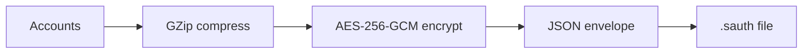

# Backup Formats (`.sauth`)

A `.sauth` file is encrypted. **No plaintext export is produced.** The kinds below exist. A `.kdbx` export is the standard
KeePass format (KDBX 4.0, Argon2id, AES-256), written by `KdbxWriter`.

## 0. Full backup (version 4, from 1.6)

The Backup page writes this. It has the same envelope as version 1 below with `"Version": 4`, but the ciphertext holds the
contents described under [Contents](#contents), without settings, and the salt is bound in as associated data. The key comes from a
password the user chooses for the file.

## Sync file (from 1.6)

Written by sync, named `vault-<date>-<time>.sauth` so it fits a server that accepts only those names. It is binary:

| Bytes | Content |
| --- | --- |
| 8 | `MSSYNC1\n` |
| 12 | AES-GCM nonce |
| 16 | AES-GCM tag |
| rest | Ciphertext of the compressed contents |

The key is the 256-bit sync code, which is random and is not derived from a password. The associated data is
`MasterSafe.Sync|v1|<file name>`, so a file cannot be passed off under another name. Sync files hold data only: never the
settings, the sync code, the WebDAV password, the save counter or the recovery key fingerprint. A file is never changed once
written. Each computer reads the files it has not seen, merges them (see `VaultMerger`) and adds a new one when needed.

## 1. Password backup (version 1, before 1.6)

Encrypted with a key derived from the master password. Written by versions before 1.6, and still read. It holds accounts only.



```json
{
  "Version": 1,
  "Salt": "<base64 Argon2id salt>",
  "KdfParameters": { "MemorySizeKib": 131072, "Iterations": 3, "DegreeOfParallelism": 4, "KeyLength": 32 },
  "Nonce": "<base64 12-byte AES-GCM nonce>",
  "Tag": "<base64 16-byte GCM tag>",
  "Ciphertext": "<base64 encrypted+compressed accounts>",
  "Compressed": true
}
```

Restore derives the key from `Salt`, `KdfParameters` and the password, decrypts and decompresses.
The parameters come from the file, so they are limited to safe ranges first (up to 1 GiB, 20 iterations,
32 lanes), and decompression stops at 64 MiB.

## 2. Recovery-key backup (version 2)

Encrypted to a recovery **public key** with hybrid ECDH P-384 + ML-KEM-768, so no password is needed to create it
and it stays safe against future quantum computers. See [PQC.md](PQC.md).

```json
{
  "Version": 2,
  "Id": "<base64 random backup id>",
  "Kem": "ECDH-P384+ML-KEM-768",
  "KemCiphertext": "<base64 encapsulation>",
  "WrapNonce": "<base64>", "WrapTag": "<base64>", "WrappedKey": "<base64 data key wrapped with the KEM secret>",
  "Nonce": "<base64>", "Tag": "<base64>", "Ciphertext": "<base64 encrypted+compressed accounts>"
}
```

The `Id` and algorithm name are authenticated data for both the key wrap and the contents, so a file cannot be
re-labelled or mixed with another. Only the private recovery key can open it.

The version 2 payload is the whole vault contents (accounts **and** passwords) as JSON. Backups made by early test
builds held only a JSON array of accounts; the reader still accepts that.

## 3. Recovery key file (`*.msrk`)

Created on the Recovery page. A JSON file with the public key readable and the private key encrypted.

```json
{
  "Version": 1,
  "Note": "MasterSafe Authenticator recovery key. Keep this file and its passphrase safe and offline...",
  "Kem": "ECDH-P384+ML-KEM-768",
  "KeyId": "<base64 random key id>",
  "CreatedUtc": "2026-10-31T12:00:00.0000000+00:00",
  "PublicKey": "<base64 public key>",
  "Salt": "<base64 Argon2id salt>",
  "Kdf": { "MemorySizeKib": 131072, "Iterations": 3, "DegreeOfParallelism": 4, "KeyLength": 32 },
  "Nonce": "<base64>", "Tag": "<base64>", "WrappedPrivateKey": "<base64 private key encrypted with the passphrase>"
}
```

The key id, algorithm and public key are authenticated data for the private key's encryption, so putting another
public key into the file is detected and the file fails to open. The passphrase must be at least 12 characters.
Argon2 parameters in the file are limited to safe ranges, and the file may not be larger than 64 KiB.

## Vault file (`vault.sauth`)

The live vault uses format 3 (see [Security.md](Security.md)): a random vault id, a list of unlock slots,
and the contents encrypted with the data key. The previous version of the file is kept as `vault.sauth.bak`.

### Contents

Before encryption the contents are compressed (GZip). They are one of two layouts, chosen by the first bytes:

| Layout | When | Shape |
| --- | --- | --- |
| Plain JSON | The vault has no attachments (always the case before 1.3.0) | `{"Accounts":[...],"Passwords":[...],"Folders":[...],"FolderIcons":{...}}` |
| Container `MSV4` | At least one entry has an attached file | `"MSV4"`, length of the JSON (int32 little-endian), the same JSON, number of files (int32), then for each file: its 16-byte id, its length (int32) and its raw bytes |

From 1.6 the JSON can also hold `Security`, `SaveCounter`, `Tombstones` and `Sync`, and entries can hold `Kind`, `Fields`,
`ExpiresUtc`, `IconPng` and `StateChangedUtc`, and accounts `Group` and `ModifiedUtc`. All are optional, and an older version
drops them when it saves. Because a card number must not be lost that way, an entry with a kind, fields or a date also carries
them as one line at the end of its notes, after the line `[MasterSafe 1.6: keep this block, ...]`. This version takes the line out
when it reads the vault, and restores what an older version dropped.

Attached files are not put inside the JSON, because that would make them a third larger. An entry only holds the
description of its files (id, name, size). The same layout is used inside recovery backups.

When reading, every length is checked before memory is reserved: the JSON part may be at most 16 MiB, one file 5 MiB,
all files together 50 MiB, and at most 1000 files. Files that no entry refers to are ignored, and the description of a file
whose bytes are missing or whose size does not match is dropped. File names are reduced to a plain name (no folders).

Limits on whole files: the vault file and backups may be up to 100 MiB, and the decompressed contents up to 96 MiB.
