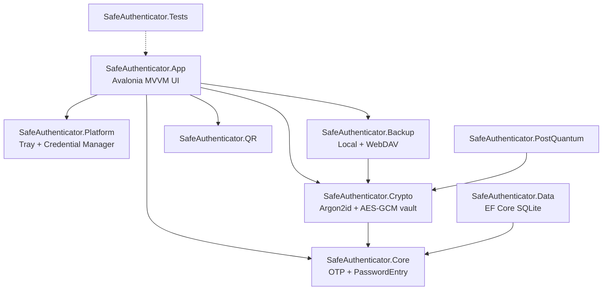
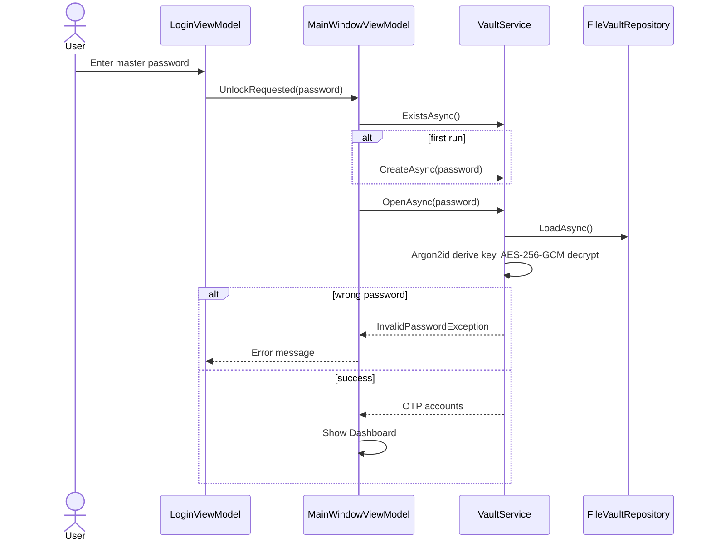
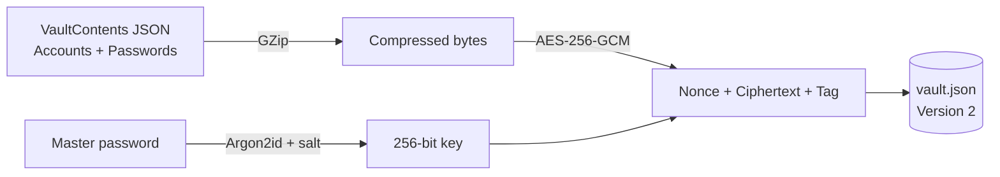
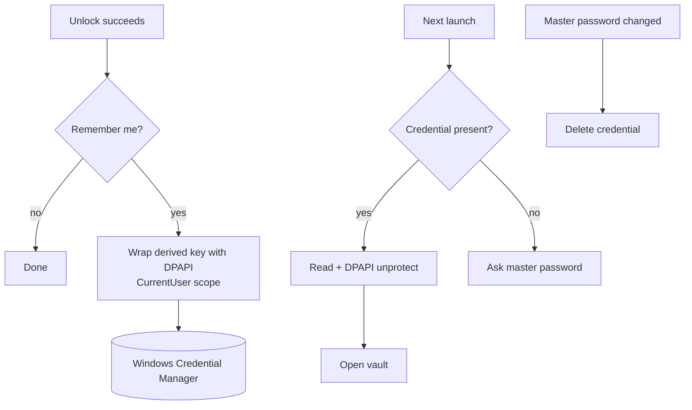
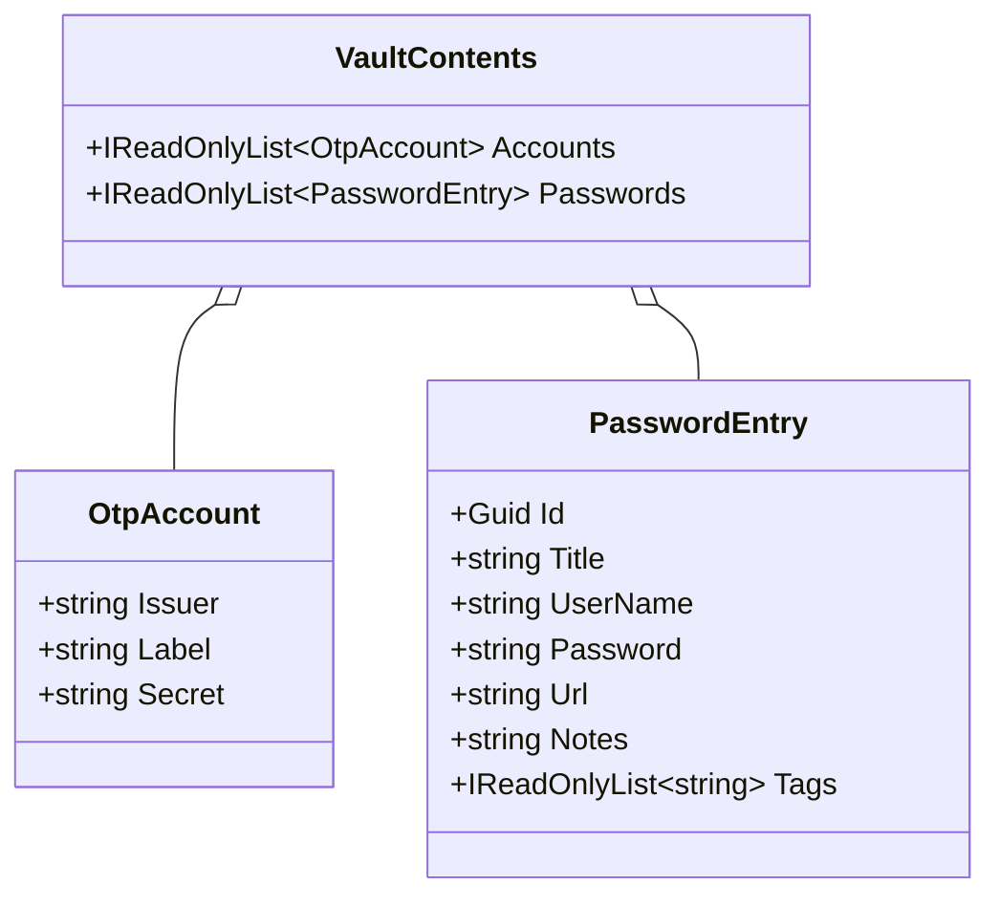

# SafeAuthenticator Documentation

**Version:** 1.1.0  
**Author:** Gabriel Vergara Ezcurdia

SafeAuthenticator is a privacy-first, offline-first authenticator (TOTP/HOTP) with an encrypted
vault that also stores KeePass-style password entries.

## 1. Solution layout

## 2. Unlocking the vault

## 3. Vault file format

Version 1 vaults (a bare JSON list of OTP accounts) are still readable and are
upgraded to version 2 on the next save.

## 4. Quick unlock with Windows Credential Manager

Status: implemented. The session holds only a derived key; "Remember me" stores it via
`ICredentialStore`/`WindowsCredentialStore` (DPAPI-wrapped), and changing the master
password replaces the stored key.

## 5. Vault contents model (implemented: passwords page, generator, 30 s clipboard clear)

## 6. Conventions

- Every source file starts with a header naming the project and author.
- Public types and members carry XML documentation comments.
- Build settings (version, authors) live in `Directory.Build.props`.
