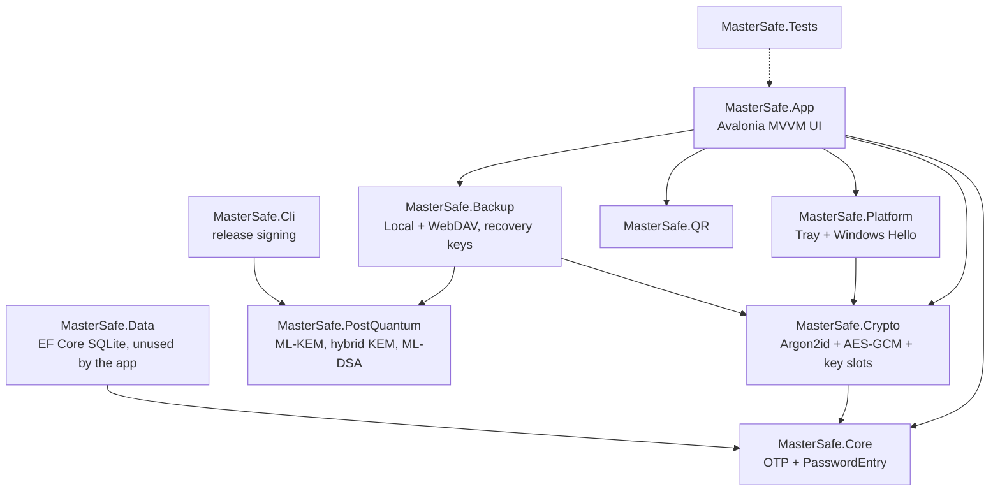
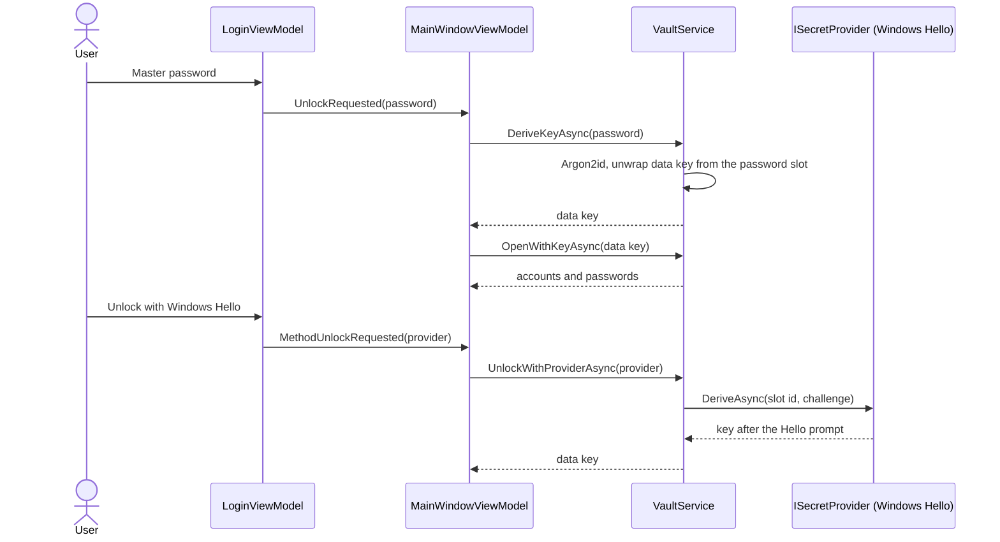
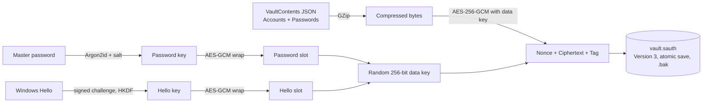
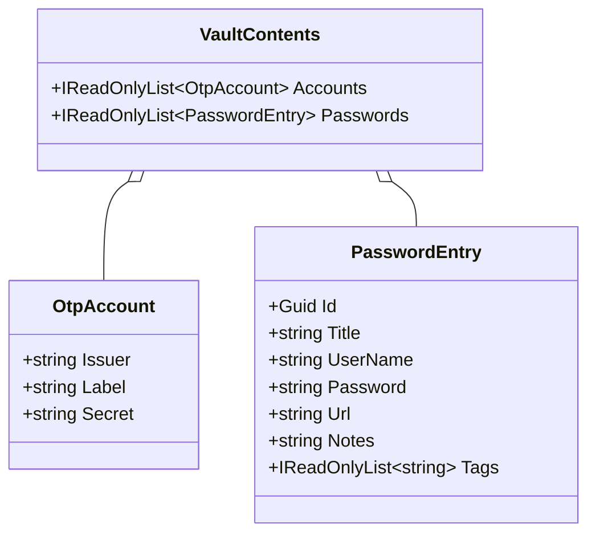

# MasterSafe Authenticator Documentation

**Version:** 1.1.0  
**Author:** Gabriel Vergara Ezcurdia

MasterSafe Authenticator is a privacy-first, offline-first authenticator (TOTP/HOTP) with an encrypted
vault that also stores KeePass-style password entries. It runs on Windows and Linux.

## 1. Solution layout

## 2. Unlocking the vault

A wrong password or a changed file raises `InvalidPasswordException` and the login screen shows an error.
Locking (button or auto-lock) zeroes the data key and clears decrypted data from the view models.

## 3. Vault file format 3

Versions 1 and 2 (a key derived straight from the password) are still readable and are upgraded to version 3
the next time the vault is unlocked with the master password. Details: [Security.md](Security.md).

## 4. Unlock methods

Settings lists the unlock methods. The master password is always present and cannot be removed. Windows
Hello can be added or removed. FIDO2 security keys use the same slot design and are planned. Changing the master
password replaces only the password slot, so other methods keep working.

## 5. Vault contents model

## 6. Start-up and screens

On start a rounded splash window shows the logo, product name, author and version for about two seconds, then the
main window opens. A left sidebar switches between Authenticator codes, Passwords, Add account, Import, Backup,
Settings and Help; Lock vault and About are at the bottom. Every input field has a label above it.

## 7. Building, testing and packaging

| Task | Windows | Linux |
| --- | --- | --- |
| Build and test | `dotnet build MasterSafe.slnx -c Release` then `dotnet test MasterSafe.slnx -c Release` | same commands |
| Run | `dotnet run --project src/MasterSafe.App` | same command |
| Installer | `./installer/build-windows.ps1 -Version <v>` (needs Inno Setup 6) | `bash installer/linux/build-linux.sh <v> linux-x64` (or `linux-arm64`) |
| Cross-build for Linux from Windows | `dotnet publish src/MasterSafe.App -c Release -r linux-x64 --self-contained -p:MasterSafeTargetOs=linux` | n/a |
| Sign a release file | `dotnet run --project src/MasterSafe.Cli -c Release -- sign <file> <key>` | same command |
| Verify a download | `MasterSafe.Cli verify <file> <pubkey>` | same command |
| Release | push a tag `v<version>`; `.github/workflows/release.yml` builds Windows and Linux, signs and drafts a release | |

Continuous integration (`.github/workflows/build.yml`) builds and tests on Ubuntu and Windows for every push and pull
request, and checks packages for known vulnerabilities. CodeQL, SBOM generation and release signing are separate
workflows. Other targets (macOS, mobile) are not built yet; the core libraries are plain `net10.0` and the
Windows-only code is isolated in `MasterSafe.Platform`.

## 8. Conventions

- Every source file starts with a header naming the project and author.
- Public types and members carry XML documentation comments.
- Build settings (version, authors, target selection) live in `Directory.Build.props`.
- Documentation is updated in the same change as the code it describes.
