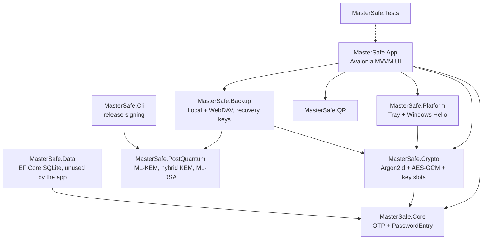
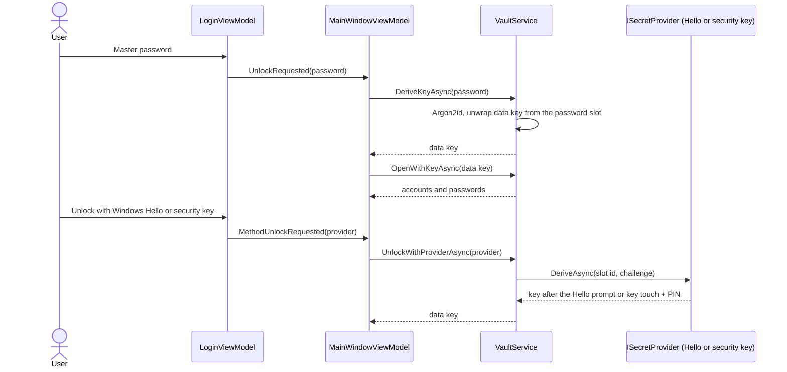
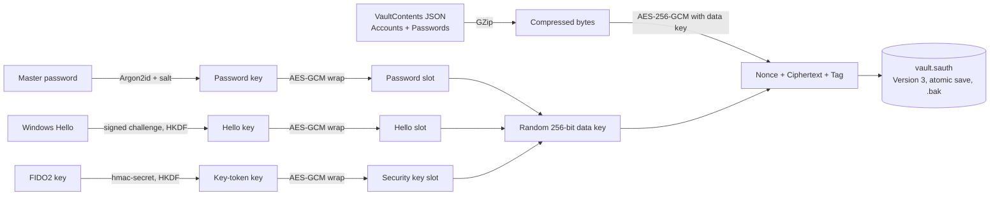
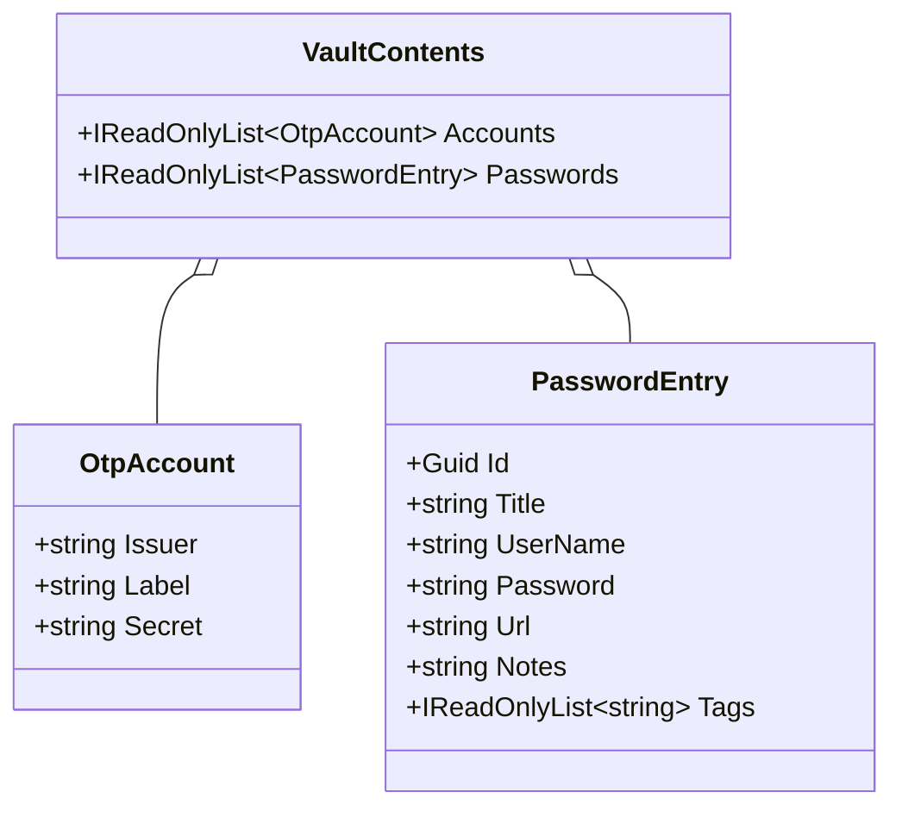

# MasterSafe Authenticator Documentation

**Version:** 1.3.1  
**Author:** Gabriel Vergara Ezcurdia

MasterSafe Authenticator is a privacy-first, offline-first authenticator (TOTP/HOTP) with an encrypted
vault that also stores KeePass-style password entries. It runs on Windows and Linux.

## 1. Solution layout

## 2. Unlocking the vault

A wrong password or a changed file raises `InvalidPasswordException` and the login screen shows an error.
Locking (button or auto-lock) zeroes the data key and clears decrypted data from the view models.

## 3. Vault file format 3

Versions 1 and 2 (a key derived straight from the password) are still readable and are upgraded to version 3
the next time the vault is unlocked with the master password. Details: [Security.md](Security.md).

## 4. Unlock methods

Settings lists the unlock methods. The master password is always present and cannot be removed. Windows
Hello and a FIDO2 security key can be added or removed. A security key must support the CTAP2 `hmac-secret`
extension; adding it takes a PIN and a touch twice and unlocking takes them once. One key can be set up per vault.
Changing the master password replaces only the password slot, so other methods keep working.

## 5. Vault contents model

## 6. Start-up and screens

On start a rounded splash window shows the logo, product name, author and version for about two seconds, then the
main window opens. A left sidebar switches between Authenticator codes, Passwords, Add account, Import, Backup,
Recovery, Vaults, Settings and Help; Lock vault and About are at the bottom. Every input field has a label above it.
The sign-in screen has "Forgot your master password?", and the first-run screen has "I already have a vault file".
Where every file is kept: [FileLocations.md](FileLocations.md).

## 7. Building, testing and packaging

| Task | Windows | Linux |
| --- | --- | --- |
| Build and test | `dotnet build MasterSafe.slnx -c Release` then `dotnet test MasterSafe.slnx -c Release` | same commands |
| Run | `dotnet run --project src/MasterSafe.App` | same command |
| Installer | `./installer/build-windows.ps1 -Version <v>` (needs Inno Setup 6) | `bash installer/linux/build-linux.sh <v> linux-x64` (or `linux-arm64`) |
| Cross-build for Linux from Windows | `dotnet publish src/MasterSafe.App -c Release -r linux-x64 --self-contained -p:MasterSafeTargetOs=linux` | n/a |
| Sign a release file | `dotnet run --project src/MasterSafe.Cli -c Release -- sign <file> <key>` | same command |
| Verify a whole downloaded release folder | `MasterSafe-Cli-<v>-win-x64.exe verify-release <folder> masterSafe-release.pub` | `./MasterSafe-Cli-<v>-linux-x64 verify-release <folder> masterSafe-release.pub` |
| Verify one file | `MasterSafe.Cli verify <file> <pubkey>` | same command |
| Show a public key fingerprint | `MasterSafe.Cli fingerprint <pubkey>` | same command |
| Release | push a tag `v<version>`; `.github/workflows/release.yml` builds Windows and Linux and drafts a release. The Windows files are signed on the Windows runner and the Linux packages in the publish job, also on Windows (the Ubuntu runner cannot make ML-DSA signatures) | |

Continuous integration (`.github/workflows/build.yml`) builds and tests on Ubuntu and Windows for every push and pull
request, and checks packages for known vulnerabilities. CodeQL, SBOM generation and release signing are separate
workflows. Other targets (macOS, mobile) are not built yet; the core libraries are plain `net10.0` and the
Windows-only code is isolated in `MasterSafe.Platform`.

## 8. Manual hardware checks

Windows Hello and security keys cannot be tested in CI, so run this list on a real PC before a release.
Unit tests cover the vault logic with a fake provider; these steps cover the real devices.

| Step | Expected |
| --- | --- |
| Settings, Add Windows Hello, then Lock vault | Hello prompt; login shows "Unlock with Windows Hello" and it opens the vault |
| Settings, Add Security key (key plugged in) | Windows asks for the key PIN and a touch twice; "Security key" appears in the list |
| Lock vault, Unlock with Security key | PIN and touch once; the vault opens with the same accounts |
| Unlock with Security key, then cancel the prompt | A "cancelled" message; the master password still works |
| Remove the security key in Settings | The login button disappears; the master password still works |
| Change the master password | Hello and the security key still unlock the vault |
| Recovery, Create and save recovery key, then Create recovery backup | A `.msrk` key file and a `recovery-*.sauth` file are written where you chose |
| Sign in screen, Forgot your master password, Restore from a recovery backup | The data returns in a new vault with the new password; the old vault is in the archive folder |
| Export a KeePass or KeePassXC database to XML or CSV, then Import, Choose an export file | A summary of passwords and accounts to add; nothing is added until Import is clicked; importing the same file again adds nothing |
| Passwords, Edit an entry, Attach a file (a PDF under 5 MB), Save, then Lock and unlock | The entry shows "1 attached file"; Edit, then Save as writes an identical copy |
| Attach a file over 5 MB | A message names the file and the limit; nothing is attached |
| Select a folder, Change icon, click an icon | The picker closes, the icon shows in the folder list and the folder pickers, and stays after Lock and unlock |
| Recovery, Create recovery key automatically, choose where to save | The key file is written and the passphrase is shown once; "I have written it down" hides it; the saved key opens with that passphrase |
| Import a KeePass XML export that has attachments | The preview lists the attached files to add; they appear on the entries |
| Passwords, type a folder name, New folder, then tick two entries and Move selected to that folder | The entries show "Folder: name" and appear under the folder; after Lock and unlock the folder is still there |
| Delete a folder that holds passwords | The passwords are still listed, one level up |
| Passwords, tick two entries, Delete selected, Yes | Only the ticked entries are removed and the vault is saved once; typing in Search first clears the ticks |
| Drag a QR code PNG from Explorer onto the unlocked window | The account appears on the dashboard; dropping it again says it is already in the vault; while locked the drop is refused |
| Vaults, Start a new vault, then Open the archived vault | The old vault opens again with its old password |
| Vaults, Delete on an archived vault | Asks first; the file is gone afterwards and the other vaults are untouched |
| Close and reopen the app | Theme, tray and auto-lock choices are remembered |

Tested on Windows 11 build 26100 (WebAuthn API version 9) with a Thales SafeNet eToken FIDO key.
A key must support the CTAP2 `hmac-secret` extension and have a PIN (Windows offers to set one).

## 9. Conventions

- Every source file starts with a header naming the project and author.
- Public types and members carry XML documentation comments.
- Build settings (version, authors, target selection) live in `Directory.Build.props`.
- Documentation is updated in the same change as the code it describes.
