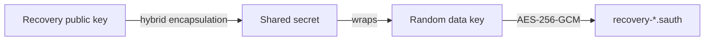

# Post-Quantum Cryptography

## What is and is not at risk

| Part | Quantum computer impact | Status |
| --- | --- | --- |
| Vault at rest (AES-256-GCM, Argon2id) | Shor's algorithm does not apply. Grover's algorithm only halves AES-256 to about 128-bit strength, which is still out of reach | Already safe with a strong passphrase |
| Public-key steps (anything encrypted *to* a key) | Broken by Shor's algorithm for RSA and elliptic curves | Protected with a hybrid scheme |
| FIDO2 security-key slot | The slot key is an HMAC-SHA-256 output computed inside the key (symmetric), so Shor's algorithm does not apply. An attacker still needs the physical key and its PIN | Not affected by quantum computers in the way RSA is |
| Release files | A signature scheme based on RSA or ECDSA would be forgeable | Signed with ML-DSA-65 |
| TLS to a WebDAV server | Controlled by the operating system | Not under this application's control |

## What is implemented

`MasterSafe.PostQuantum` uses the post-quantum algorithms built into .NET 10, which call the operating system's
cryptography provider (Windows CNG or OpenSSL 3.5+). Nothing is hand-written. Where the provider is missing,
`IsAvailable` is false and the code throws instead of returning insecure output.

- **ML-KEM-768 (FIPS 203)**: `MlKemProvider`.
- **Hybrid ECDH P-384 + ML-KEM-768**: `HybridKemProvider`. The two shared secrets are combined with HKDF-SHA-384
  together with both public keys and both ciphertexts, so the result stays secret if *either* algorithm survives.
  Use `PostQuantumProviderFactory.CreateHybrid()` for new encryption.
- **ML-DSA-65 (FIPS 204)**: `ReleaseSigner` signs release files. The public key is published with the project;
  anyone can check a download with `MasterSafe.Cli verify <file> <publickey>`.

## Recovery-key backups

`RecipientBackupService` creates backups encrypted to a **recovery public key**, with no password.

The backup holds the whole vault (accounts and passwords). Any device holding the public key (a second computer,
later a phone) can write a backup. Only the holder of the
private recovery key can open it, and keep it offline. The backup id and algorithm are bound into the encryption.

## Platform support

`MLKem.IsSupported` and `MLDsa.IsSupported` depend on the operating system. They are true on this project's
Windows 11 development machine. On Linux they need OpenSSL 3.5 or newer. Features that need them are
checked at run time, and the vault itself never depends on them, so vaults stay portable.

## In the app

- **Recovery page**: creates the recovery key (the private key goes into a passphrase-protected `.msrk` file that you
  save yourself; the app keeps only the public key) and creates recovery backups of the whole vault.
- **Forgot your master password**: restores a recovery backup into a new vault. See [Security.md](Security.md).

## Not done yet
- A post-quantum design for the Windows Hello unlock slot. Hello uses an RSA key held in the TPM, and RSA is
  breakable by a quantum computer. The slot is still safe against someone who only has the vault file, because
  the RSA public key is not stored in it, and the master-password slot does not use RSA at all. An attacker
  who could also read the public key from your computer and had a large quantum computer could in theory
  forge the Hello signature. If that matters to you, do not add Windows Hello to the vault.
