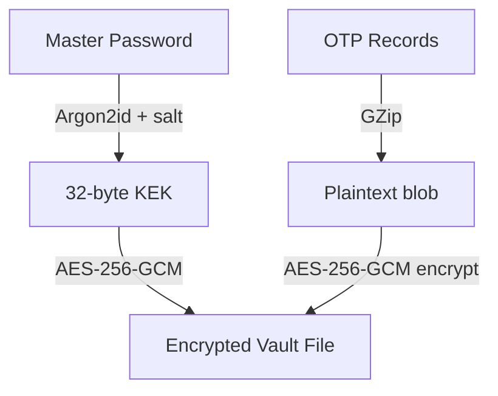

# Security Model

## Key hierarchy

## Primitives

| Concern | Choice | Notes |
| --- | --- | --- |
| KDF | Argon2id | Default 64 MiB / 3 iters / p=4, 16-byte salt |
| Symmetric | AES-256-GCM | 12-byte nonce, 16-byte tag, AEAD |
| OS wrap (Windows) | DPAPI (CurrentUser) | Optional defence-in-depth |
| OTP | RFC 6238 / RFC 4226 | SHA1/SHA256/SHA512 |

## Guarantees

- No plaintext secrets at rest — the vault stores only ciphertext + nonce + tag + salt.
- Wrong password or tampering is detected by the GCM auth tag and surfaced as `InvalidPasswordException`.
- Key rotation re-derives a fresh KEK from a new salt and re-encrypts all records.

## Recovery

Recovery requires the master password. There is intentionally no backdoor. Users are expected to keep
an encrypted `.sauth` backup (see [BackupFormat.md](BackupFormat.md)); losing the master password means
the vault cannot be decrypted.
