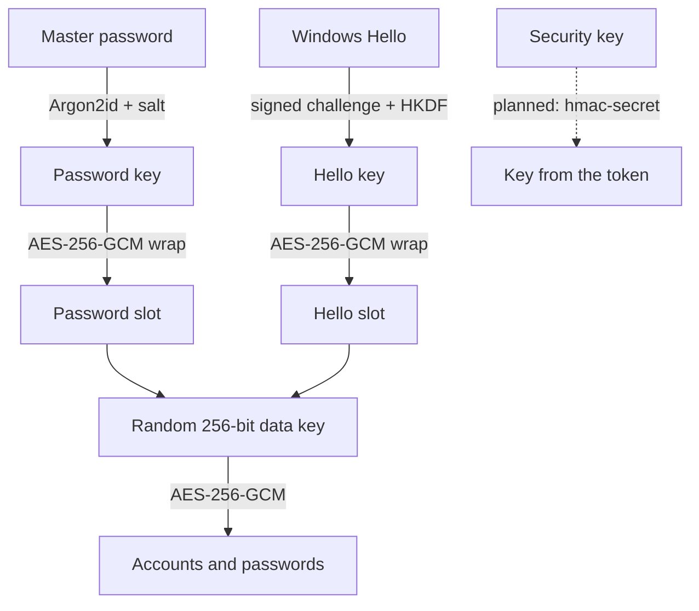

# Security Model

This page describes what MasterSafe Authenticator protects, how, and where the limits are. It makes no
promise that the software cannot be attacked. See [ThreatModel.md](ThreatModel.md) for what is in and out of scope.

## Key hierarchy (vault format 3)

The vault contents are encrypted with one random 256-bit **data key**. That key is stored once per unlock
method (a "slot"), wrapped under a key that only that method can produce. Consequences:

- Changing the master password, or adding or removing Windows Hello, never re-encrypts the contents.
- Windows Hello (and later security keys) are real second ways to unlock. Nothing stored on disk can open
  the vault without the Hello prompt, and the master password always keeps working.
- Every encryption binds the vault identifier as associated data, and every slot also binds its own id and
  type. Pieces of one vault cannot be swapped into another, and a slot cannot be relabelled.

## Primitives

| Concern | Choice | Notes |
| --- | --- | --- |
| Password KDF | Argon2id | Default 128 MiB, 3 iterations, 4 lanes, 32-byte salt. Read from the file but limited to 1 GiB, 20 iterations and 32 lanes |
| Symmetric | AES-256-GCM | 12-byte random nonce, 16-byte tag, authenticated |
| Windows Hello | RSA PKCS#1 signature of a stored challenge, then HKDF-SHA-256 | The private key stays in the TPM or Windows' protected store and needs the Hello prompt |
| Hybrid post-quantum KEM | ECDH P-384 + ML-KEM-768, HKDF-SHA-384 | Used for recovery-key backups, see [PQC.md](PQC.md) |
| Release signatures | ML-DSA-65 (FIPS 204) | `MasterSafe.Cli sign` and `verify` |
| OTP | RFC 6238 / RFC 4226 | SHA-1, SHA-256, SHA-512 |

## Protections in the code

- **Atomic saves.** The new vault is written and flushed to a temporary file and then swapped in, and the
  previous version is kept as `vault.sauth.bak`. A crash or power loss cannot leave half a vault.
- **Untrusted file input.** Argon2 parameters, file size (16 MiB vault, 32 MiB download) and decompressed size
  (64 MiB) are limited before any work is done, so a crafted file cannot exhaust memory or CPU.
- **Wrong key never overwrites.** A save first proves the key can open the existing vault.
- **Locking wipes memory.** Locking (manually or after the idle time set in Settings) zeroes the data key and
  removes accounts, passwords and typed secrets from the screens' models. Keys and password bytes are
  zeroed after use. Managed strings such as the master password the user typed cannot be zeroed by .NET;
  they remain until garbage collected.
- **Backups over https only.** WebDAV addresses must be `https://` (plain `http://` is allowed only on
  the same computer) and may not contain a user name or password.
- **No raw key stored.** The older "remember me" feature, which kept the vault key in Windows Credential
  Manager, was removed. Windows Hello replaces it.

## Older vaults

Vault formats 1 and 2 (a key derived directly from the password) can still be opened. They are upgraded to
format 3 the next time the vault is unlocked with the master password.

## Recovery

Recovery requires the master password, a set-up unlock method, or a recovery-key backup. There is no
backdoor. If you lose all of them, the vault cannot be decrypted. Keep an encrypted backup
(see [BackupFormat.md](BackupFormat.md)).

## Reporting a vulnerability

Please report security issues privately through the repository's Security tab on GitHub
(**Report a vulnerability**) instead of opening a public issue.
