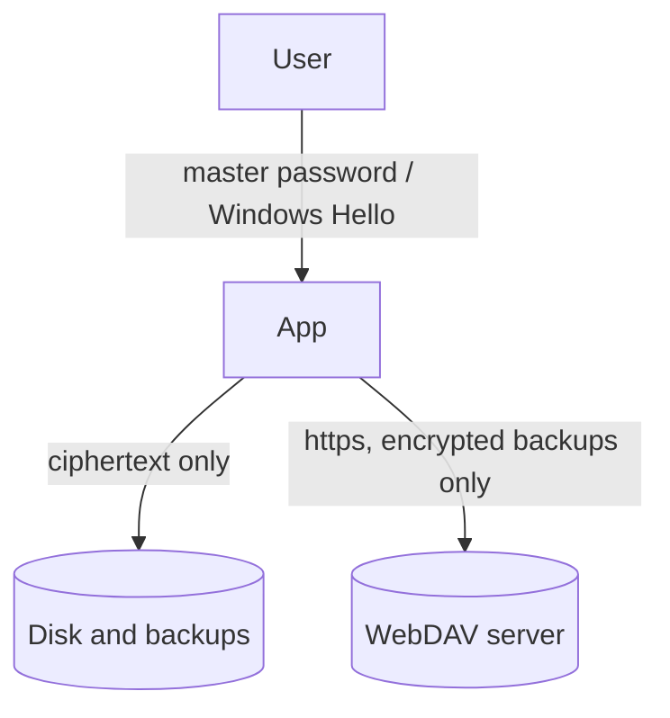

# Threat Model

## Assets

- OTP shared secrets and stored passwords (highest value).
- The master password and any hardware-bound unlock credential.
- Vault metadata (issuers, labels, titles).

## Trust boundaries

## Attackers and outcomes

| Attacker | Can they read the vault? | Why |
| --- | --- | --- |
| Steals the vault or a backup file | Only by guessing the master password | AES-256-GCM, Argon2id (128 MiB). Strength depends on a long passphrase |
| Edits the vault file | No, they can only break it | Everything is authenticated, headers and slots included. A damaged file fails closed and `.bak` holds the previous version |
| Crafts a hostile file | No | Parameters, sizes and decompression are limited before use |
| Has a future quantum computer | Not by attacking the encryption | AES-256 and Argon2id are not broken by Shor's algorithm. Grover only halves AES-256 to about 128 bits. Recovery-key backups use a hybrid post-quantum scheme |
| Runs malware as you while the vault is **locked** | No | Nothing on disk opens the vault without the password or the Hello prompt. The data key is not stored |
| Runs malware as you while the vault is **unlocked** | Yes | See below |
| Has your computer and your Windows PIN | Yes, via Windows Hello | Hello is as strong as your PIN or biometrics |
| Watches the network | No | Only ciphertext leaves the computer, and WebDAV needs https |

## Mitigations for the unlocked state

An unlocked application can always be read by software running as the same user. To shorten the window, the
vault locks after a period of inactivity (set in Settings), wipes the data key and decrypted data when it
locks, and clears copied passwords from the clipboard after 30 seconds.

## Out of scope

- A compromised operating system, malicious drivers, or malware with memory access while the vault is unlocked.
- Keyloggers capturing the master password or Windows PIN.
- Screen capture of codes while they are displayed.
- Windows clipboard history or cloud clipboard capturing a copied value before it is cleared.
- Physical attacks on the TPM.
- Weak master passwords. The application requires at least 8 characters; a longer passphrase is much safer.

## Known gaps (planned)

- FIDO2 security keys as an unlock method (the vault format already supports them; the Windows and Linux
  token integration is not implemented yet).
- Linux has no hardware unlock method yet; the master password works everywhere.
- A confirmation step before deleting an account.
