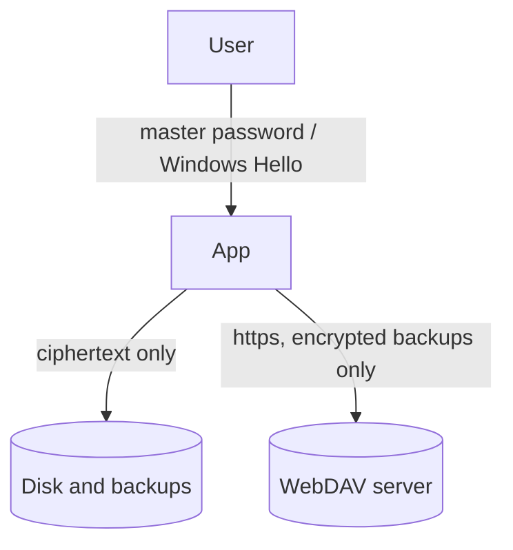

# Threat Model

## Assets

- OTP shared secrets and stored passwords (highest value).
- The master password and any hardware-bound unlock credential.
- Vault metadata (issuers, labels, titles).

## Trust boundaries

## Attackers and outcomes

| Attacker | Can they read the vault? | Why |
| --- | --- | --- |
| Steals the vault or a backup file | Only by guessing the master password | AES-256-GCM, Argon2id (128 MiB). Strength depends on a long passphrase |
| Edits the vault file | No, they can only break it | Everything is authenticated, headers and slots included. A damaged file fails closed and `.bak` holds the previous version |
| Crafts a hostile file | No | Parameters, sizes and decompression are limited before use |
| Has a future quantum computer | Not by attacking the encryption | AES-256 and Argon2id are not broken by Shor's algorithm. Grover only halves AES-256 to about 128 bits. Recovery-key backups use a hybrid post-quantum scheme |
| Runs malware as you while the vault is **locked** | No | Nothing on disk opens the vault without the password or the Hello prompt. The data key is not stored |
| Runs malware as you while the vault is **unlocked** | Yes | See below |
| Has your computer and your Windows PIN | Yes, via Windows Hello | Hello is as strong as your PIN or biometrics |
| Has your security key but not its PIN | No | The vault asks the key for a secret, and the key requires its PIN and a touch. Too many wrong PINs lock the key |
| Gets a file you saved out of an entry ("Save as...") | Yes, that file | A saved attachment is a normal file on disk and is no longer protected by the vault. The app says so when it saves one; delete it when you are done |
| Watches the network | No | Only ciphertext leaves the computer, and WebDAV needs https |

## Recovery and old vaults

| Risk | Position |
| --- | --- |
| Someone finds your recovery key file | They also need its passphrase. The key file holds the private key encrypted with Argon2id and AES-256-GCM. Keep file and passphrase apart |
| Someone finds a recovery backup | It is encrypted to the recovery public key (hybrid, post-quantum). Without the private key it is unreadable |
| Someone gets both the key file and its passphrase | They can read every recovery backup you made. Treat them like the master password |
| An archived old vault | Still encrypted under its old password. It stays on disk until you delete it, so an old password that leaked still protects only that old data |
| `settings.json` | Holds no secrets: theme, paths and the recovery **public** key |
| A recovery backup that is out of date | Restoring gives the data as of the backup. The Recovery page shows when the last one was made |

## Mitigations for the unlocked state

An unlocked application can always be read by software running as the same user. To shorten the window, the
vault locks after a period of inactivity (set in Settings), wipes the data key and decrypted data when it
locks, and clears copied passwords from the clipboard after 2 minutes (a new copy restarts the wait; text that is no longer a copied secret is not touched).

## Out of scope

- A compromised operating system, malicious drivers, or malware with memory access while the vault is unlocked.
- Keyloggers capturing the master password or Windows PIN.
- Screen capture of codes while they are displayed.
- Windows clipboard history or cloud clipboard capturing a copied value before it is cleared.
- Physical attacks on the TPM.
- Weak master passwords. The application requires at least 8 characters; a longer passphrase is much safer.

## Known gaps (planned)

- Linux has no hardware unlock method yet (Windows Hello and the FIDO2 integration use Windows APIs); the master
  password works everywhere. A Linux FIDO2 backend (libfido2) is planned.
- Only one security key can be set up per vault. Adding a second key replaces the first.
- A security key must support the CTAP2 `hmac-secret` extension. Older U2F-only keys do not.
