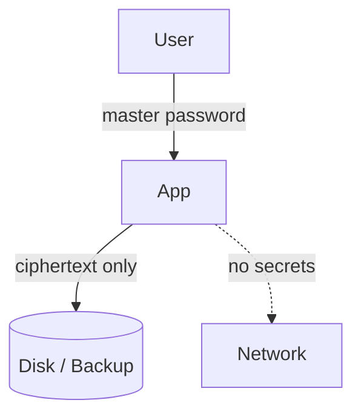

# Threat Model

## Assets

- OTP shared secrets (highest value).
- Master password.
- Vault metadata (issuers, labels).

## Trust boundaries

## STRIDE summary

| Threat | Vector | Mitigation |
| --- | --- | --- |
| Spoofing | Fake vault file | AES-GCM auth tag rejects foreign/tampered data |
| Tampering | Edit ciphertext | GCM authentication fails and raises `InvalidPasswordException` |
| Repudiation | N/A (local app) | Out of scope |
| Information disclosure | Disk/backup theft | Argon2id + AES-256-GCM; optional DPAPI |
| DoS | Corrupt vault | Fails closed; backups enable recovery |
| Elevation | Weak KDF params | Argon2id tuned to OWASP guidance |

## Out of scope

- Compromised OS / malware with memory access while the vault is unlocked.
- Keyloggers capturing the master password.
- Clipboard leakage after an explicit user copy (mitigated by auto-clear in the staged UI).
